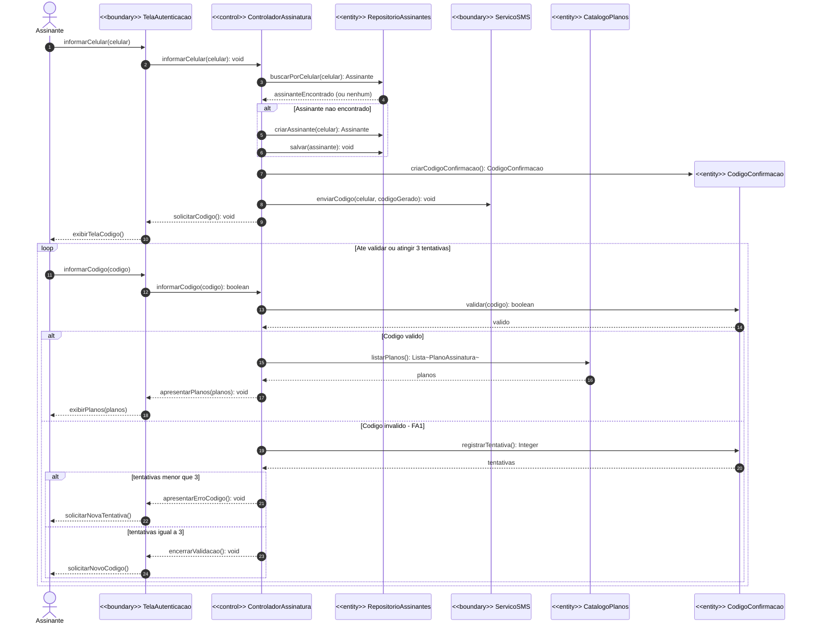
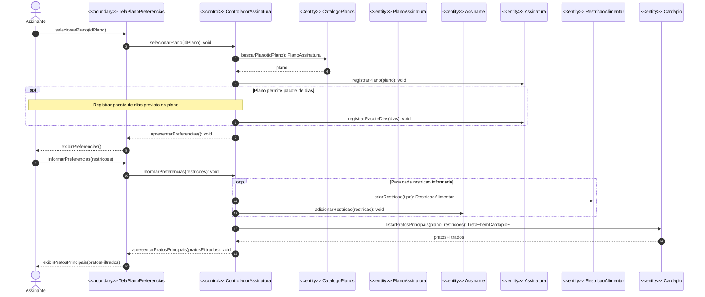
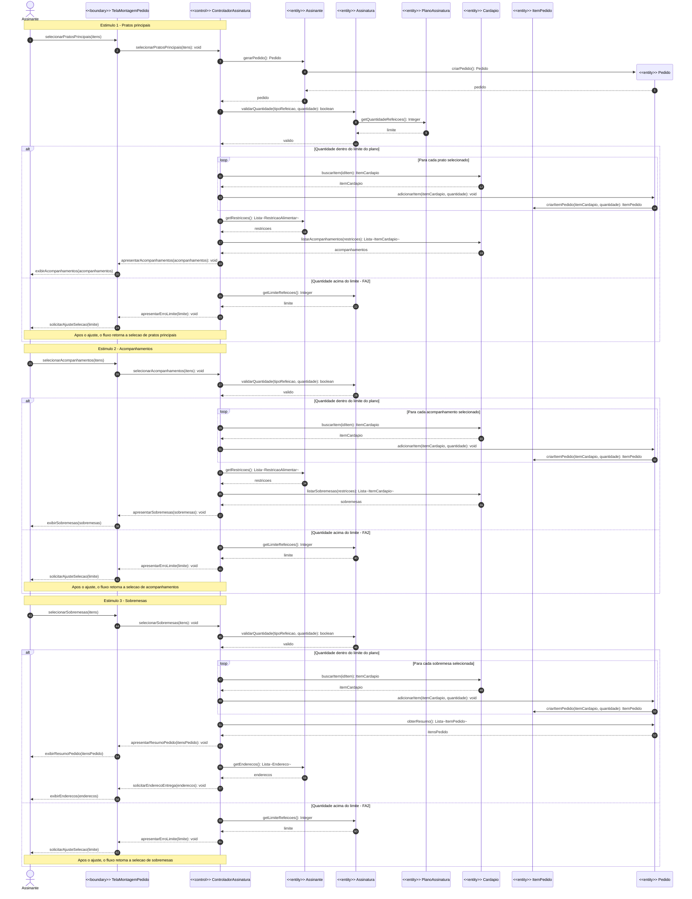
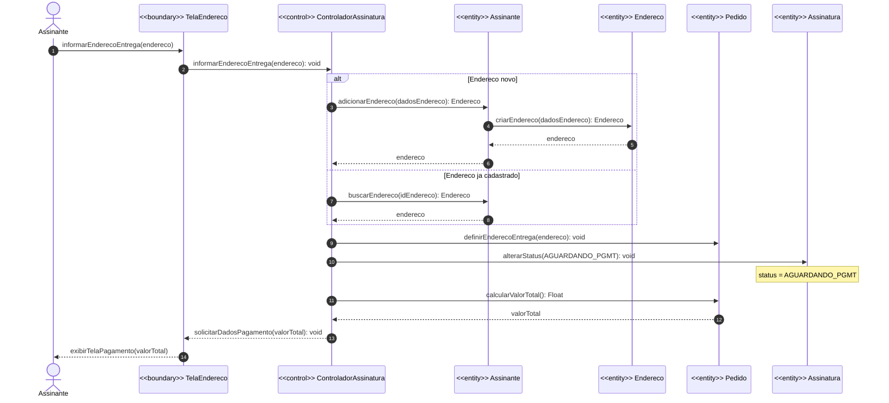
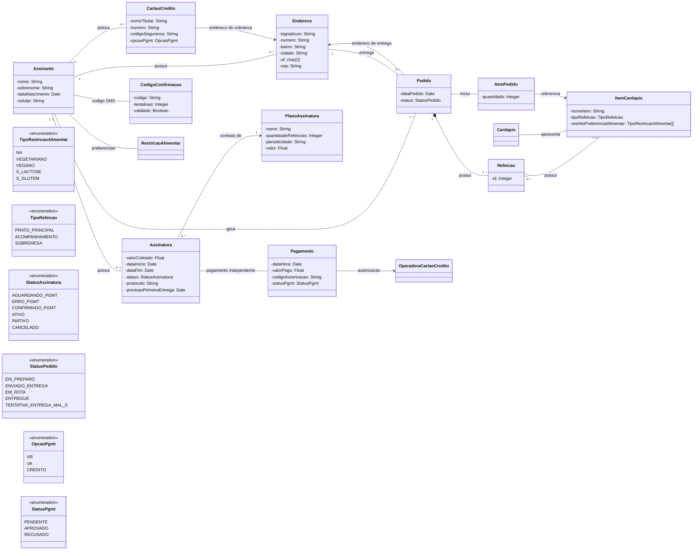

# Wiki N1 - Meal Subscription Service

**Projeto acadêmico de Engenharia de Software para contratação e gerenciamento de assinaturas de marmitas contemplando o cadastro do assinante, controle de pedidos (seleção de planos de refeições, preferências alimentares, cardápio personalizado), recorrência da entrega e processamento de pagamentos.**

**04N - Profa. Ana Claudia Rossi**

## Membros do Grupo
* Caroline Lee - 10264791
* Matheus Medeiros - 10748040
* Beatriz Siqueira - 10741570

---

## 1. Lista de Classes Candidatas Identificadas

* 🔗 **Casses Candidatas:** [Classes Candidatas](/docs/classes_candidatas.md)

---

## 2. Protótipo (Sequência de Telas e Caminho Feliz)

O storyboard ilustra o fluxo ideal do usuário na plataforma: 
`Criação da conta` ➔ `Escolha do plano de refeições` ➔ `Filtro de preferências e seleção do cardápio` ➔ `Checkout` ➔ `Tela de sucesso`.

* 🔗 **Acesso ao Protótipo:** https://www.figma.com/design/tNJninqAPZxRja7Ed4Swx3/Beatriz-de-Assis-Siqueira-s-team-library?node-id=0-1&t=7E1IHlFpNNH7joOF-1
* 🔗 **Estrutura do Design:** [Design Structure](/docs/design_structure.pptx)

---

## 3. Vídeo Explicativo e Distribuição de Responsabilidades

* 🎥 **Assistir à Apresentação:** https://youtu.be/F8k4WEhj0Kg?is=SAWOn4MUsja3hRMI

### Divisão de Tarefas da Equipe:
* **Beatriz Assis:** Prototipação das telas do fluxo de cadastro via número de telefone e plano de assinatura, e design da aplicação (paleta de cores, elementos gráficos, tipografia e plataforma).
* **Matheus Medeiros:** Levantamento das classes candidatas, design da aplicação (logotipo) e prototipação das telas de endereço, pagamento, confirmação do pedido e status do pedido.
* **Caroline Lee:** Gravação/edição do vídeo, elaboração do roteiro e prototipação da sequencia de preferência alimentar, prato principal, acompanhamento, sobremesa e resumo do pedido.

## 4. Diagrama de Domínio:

# Wiki N2 - Meal Subscription Service

# Diagrama de Sequência 1 — Autenticação por SMS

# Diagrama de Sequência 2 — Plano e Preferências

# Tabela de Estímulos

| # | Estímulo | Tela do protótipo | Passos do fluxo | Alternativo |
|---|----------|-------------------|-----------------|-------------|
| 1 | `informarCelular` | iPhone 17 - 1 | 1–2 | – |
| 2 | `informarCodigo` | iPhone 17 - 6 | 3–5 | FA1 |
| 3 | `selecionarPlano` | iPhone 17 - 3 | 6–7 | – |
| 4 | `informarPreferencias` | iPhone 17 - 4 | 8–10 | – |
| 5 | `selecionarPratosPrincipais` | iPhone 17 - 5 | 11–13 | FA2 |
| 6 | `selecionarAcompanhamentos` | iPhone 17 - 7 | 14–16 | FA2 |
| 7 | `selecionarSobremesas` | iPhone 17 - 8 (resumo na 9) | 17–20 | FA2 |
| 8 | `informarEnderecoEntrega` | iPhone 17 - 10 e 11 | 21–24 | – |
| 9 | `informarDadosCartao` | iPhone 17 - 12 e 13 | 25 | – |
| 10 | `confirmarPedido` | iPhone 17 - 17 (resultado em 18 e 19) | 26–32 | FA3 |

---

# Diagrama de Sequência 3 — Montagem do Pedido

---

# Diagrama de Sequência 4 — Endereço de Entrega

## Diagrama de Domínio Corrigido — N2

